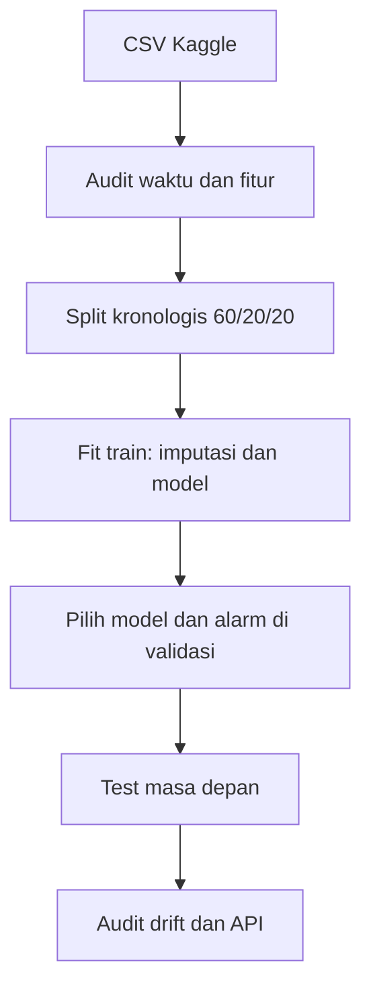

# Audit Risiko Recovery Flotasi dengan Machine Learning

**Studi portofolio proses mineral | Data Science & AI Engineering | Bahasa Indonesia**

Model machine learning untuk **memeringkat kondisi proses rougher yang berisiko menghasilkan recovery rendah**, dengan pembanding regresi numerik yang hasilnya juga dilaporkan. Kode mencakup unduhan data, validasi timestamp, split berdasarkan waktu, dua algoritme klasifikasi, pemilihan model dan ambang alarm di validasi, audit input bergeser, interpretasi fitur, grafik, berkas prediksi untuk audit, serta API demonstrasi.

> **Klaim yang tepat:** Data ini berasal dari mirror Kaggle atas catatan pemulihan emas. **Bukan data AMMAN** dan tidak diketahui kesetaraan proses, sensor, definisi label, waktu rilis lab, maupun izin operasional pabrik. AMMAN mengolah tembaga dan emas melalui konsentrator; hasil eksperimen ini hanya menunjukkan *metode* untuk menguji model pada proses mineral. Ambang recovery 75% adalah pilihan ilustratif penelitian, **bukan spesifikasi atau target AMMAN**. Tidak ada klaim peningkatan recovery/keuntungan/efisiensi AMMAN.

## Alasan relevan untuk departemen proses

[Halaman karier AMMAN untuk Processing Department](https://careers.amman.co.id/go/Mineral-Processing-Plant-Careers/569544/) menyebut tanggung jawab mengolah bijih menjadi konsentrat berkualitas dan mengoperasikan konsentrator serta filter plant. [AMMAN juga memaparkan penggunaan inovasi AI bersama optimasi milling, grinding, dan flotasi](https://www.amman.co.id/article/amman-wins-top-asean-award-for-best-mineral-processing-practices). Tugas dalam repo ini menguji bagaimana tim proses dan data science bisa menilai **peringatan untuk ditinjau manusia** dari sensor rougher, termasuk kapan model harus ditahan karena input berada di luar rentang pelatihan. Ia tidak menebak konfigurasi atau strategi kontrol yang dipakai AMMAN.

**Pertanyaan penelitian:** Apakah model dengan data input dan keadaan sel flotasi mampu memeringkat kejadian recovery rougher `<75%` pada periode waktu berikutnya lebih baik dari tebakan acak berdasar prevalensi? Apakah frekuensi alarm tetap mendekati anggaran review yang ditetapkan pada validasi?

## Dataset dan integritas data

- Dataset: [Gold_recovery_full di Kaggle](https://www.kaggle.com/datasets/manuelantoniocherres/gold-recovery-full), mirror publik dengan `gold_recovery_full.csv` (~23 MB, 22.716 baris dan 87 kolom). Metadata Kaggle menyebut CC0. Pembuat dan asal operasional primer **tidak dapat diverifikasi hanya dari halaman mirror**; jangan menyebutnya data milik AMMAN atau menjadikannya bukti kesiapan industri.
- Rentang waktu CSV: Januari 2016 sampai Agustus 2018. Target `rougher.output.recovery` tersedia pada 19.597 baris. Sebagian label bernilai nol dan memerlukan pemeriksaan bersama metallurgist.
- **22 fitur yang diizinkan:** `rougher.input.*` (kadar umpan, laju/ukuran umpan, reagen) dan `rougher.state.*` (aliran udara, level). Nama terperinci ada di `src/data.py` dan `GET /fitur`.
- **Dilarang untuk model:** `rougher.output.*`, `rougher.calculation.*`, tahapan cleaner/final, semua konsentrat/tailing, dan target itu sendiri. Nilai keluaran dipakai dalam perhitungan recovery sehingga memasukkannya akan membocorkan jawaban.
- Input dan target pada timestamp yang sama. Model ditafsirkan sebagai *risk scoring* bersamaan dengan pembacaan sensor. **Tanpa cap waktu kapan assay tersedia, model belum terbukti memberi peringatan sebelum lab.**
- Data mentah diunduh dari sumber, tidak dibundel ulang di repo/ZIP. Model, grafik, laporan, dan prediksi test di `artifacts/` berasal dari eksperimen yang benar-benar dijalankan.

## Desain eksperimen



| Komponen | Aturan |
| --- | --- |
| Split | 60% train, 20% validasi, 20% test dari **semua baris waktu sebelum membuang target kosong**. Tidak ada shuffling. |
| Label | `rougher.output.recovery < 75`, hanya bila target tersedia. Nol tetap dihitung sambil ditandai sebagai keterbatasan. |
| Pemrosesan | Median fitur di-fit **hanya pada train** melalui `Pipeline`; skala hanya dipakai regresi logistik. |
| Model | Regresi logistik seimbang kelas dan `HistGradientBoostingClassifier`; tanpa pencarian hiperparameter memakai test. |
| Pemilihan | Average precision (AP) validasi tertinggi. Model terpilih HGB. |
| Kebijakan alarm | Persentil ke-98 skor validasi, setara anggaran review sekitar 2% di validasi; ambang yang sama dipakai pada test dan API. |
| Evaluasi | AP, ROC-AUC, Brier, presisi, recall, porsi alarm, matriks kebingungan, serta *lift* dari prevalensi. |
| Interpretasi | Permutation importance memakai **sampel validasi**, bukan test; dampak permutasi adalah keterkaitan prediktif, bukan kausalitas. |
| Input API | Menahan prediksi jika satu fitur keluar dari persentil 0,5–99,5 train; batas ini hanyalah demonstrasi gate, bukan rentang operasi resmi. |

## Hasil eksperimen asli

Test dilakukan pada bagian waktu terakhir, **10 Februari–18 Agustus 2018**, dengan **3.914 baris berlabel**. Kejadian recovery `<75%` adalah **3,6%** dari baris tersebut. AP acak kira-kira sama dengan prevalensi (0,036).

| Kandidat | AP validasi ↑ | AP test ↑ | ROC-AUC test ↑ | Brier test ↓ |
| --- | ---: | ---: | ---: | ---: |
| Regresi logistik | 0,249 | **0,284** | **0,839** | 0,341 |
| HistGradientBoosting, dipilih dari validasi | **0,265** | 0,191 | 0,746 | **0,109** |

Ambang skor HGB yang dipilih dari validasi adalah **0,595**. Pada test, **9,1%** baris berlabel memicu alarm; presisi alarm **18,4%**, recall **46,5%**, dan lift presisi sekitar **5,1×** terhadap prevalensi. Model memang memeringkat sebagian risiko di atas acak, tetapi **anggaran alarm 2% tidak bertahan** pada test. Regresi logistik ternyata memiliki AP test lebih tinggi, sedangkan pemilihannya harus tetap mengikuti aturan validasi yang sudah ditetapkan. Skor HGB belum dikalibrasi sebagai probabilitas kejadian.

Sekitar **40,8%** baris test memiliki minimal satu fitur di luar rentang persentil 0,5–99,5 train. Akibatnya, gate input yang dinyalakan di API akan menahan banyak baris; metrik test di tabel dihitung **sebelum gate**, sehingga tidak mewakili performa pada trafik yang lolos gate saja. Perbedaan ini menuntut studi drift dan evaluasi cakupan pada tiap kampanye bijih.

Permutasi di validasi menempatkan `rougher.input.feed_au`, level sel 10a, dan `rougher.input.feed_sol` di urutan teratas. Kadar umpan Au kemungkinan merupakan hasil assay yang tidak selalu tersedia segera; jika pada sistem nyata terlambat, fitur tersebut harus dikeluarkan dan **semua model serta metrik dilatih ulang**. Ranking ini tidak membenarkan perubahan setpoint.

Eksperimen pendamping di `src/benchmark_regresi.py` menguji prediksi recovery sebagai nilai numerik. Pada test, **MAE acuan median train 8,308**, Ridge **9,616**, dan gradient boosting **11,852** poin persentase. Karena keduanya kalah dari median, model regresi **tidak direkomendasikan** sebagai estimasi numerik pada dataset ini. Kegagalan itu tetap ada di `artifacts/regresi/` untuk memperlihatkan evaluasi yang jujur.


## Menjalankan di Windows PowerShell

```powershell
py -3.12 -m venv .venv
.\.venv\Scripts\Activate.ps1
python -m pip install -r requirements.txt
python -m src.unduh_data
python -m src.latih
python -m src.benchmark_regresi --out artifacts/regresi
python -m pytest -q
python -m src.contoh_api > payload.json
uvicorn src.api:app --host 127.0.0.1 --port 8000
```

Di terminal PowerShell kedua:

```powershell
Invoke-RestMethod -Method Post -Uri http://127.0.0.1:8000/prediksi -ContentType 'application/json' -InFile payload.json
```

Jika PowerShell menolak aktivasi venv, jalankan `.\.venv\Scripts\python.exe -m ...` untuk setiap perintah Python. Di Linux/macOS, aktivasi memakai `source .venv/bin/activate`. Setelah pelatihan, `docker build -t audit-recovery .` dan `docker run --rm -p 8000:8000 audit-recovery` menyediakan API yang sama; jangan expose ke jaringan umum tanpa autentikasi dan pemantauan.

API `POST /prediksi` menerima satu timestamp dan tepat 22 nilai fitur. Payload contoh memakai median train yang diulang, sehingga **hanya uji skema**. Respons memuat skor risiko (belum terkalibrasi), alarm review, dan ambang ilustratif. `GET /health` dan `GET /fitur` membantu pemeriksaan layanan. Model disimpan dengan `joblib`; muat hanya artefak dari sumber tepercaya.

## Kontribusi yang mungkin diuji bersama AMMAN

1. Peta tag historian dan definisi recovery rougher di konsentrator yang sesuai, termasuk jam pengambilan sampel, jam hasil lab tersedia, downtime, setpoint, dan pergantian jenis bijih.
2. Data pipeline dengan pemisahan waktu dan pemeriksaan leakage, unit, sensor rusak, serta *out-of-distribution* sebelum model dipakai untuk review.
3. Uji *shadow mode* tanpa mengendalikan pabrik: bandingkan ketepatan dan beban alarm antar shift/kampanye bijih, catat respons operator dan waktu tanggap.
4. Tetapkan ambang alarm dan KPI proses **bersama metallurgist**, lalu jalankan validasi prospektif sebelum menghitung manfaat ekonomi. Lihat [`docs/RENCANA_PILOT.md`](docs/RENCANA_PILOT.md).

Repo ini tidak menyediakan resep setpoint dan tidak dipakai untuk kendali otomatis. Nilai importance bukan petunjuk mengubah reagen atau aliran udara.

## Struktur

```text
audit-recovery-flotasi-ml/
├── README.md
├── requirements.txt / requirements-api.txt
├── Dockerfile, LICENSE, .gitignore
├── src/
│   ├── unduh_data.py          # Kaggle
│   ├── data.py                # kontrak 22 fitur dan split waktu
│   ├── latih.py               # klasifikasi dan alarm
│   ├── benchmark_regresi.py   # eksperimen numerik pembanding
│   ├── api.py                 # API validasi input
│   └── contoh_api.py          # payload demonstrasi
├── tests/test_data.py
├── docs/RENCANA_PILOT.md
├── docs/KARTU_MODEL.md
└── artifacts/                 # hasil asli dan model yang dapat diaudit
```

**GitHub:** Buat repository public bernama `audit-recovery-flotasi-ml` tanpa README/.gitignore/license otomatis, lalu unggah **isi folder** hasil ekstraksi ZIP ke akar repository. CSV mentah berada di `data/` dan diabaikan Git. Ini adalah karya portofolio independen Tegar Reski Pratama, bukan proyek, kerja sama, atau pernyataan resmi AMMAN.
